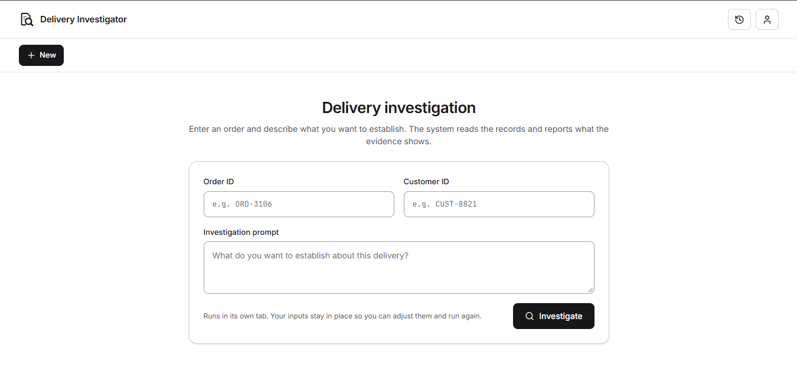
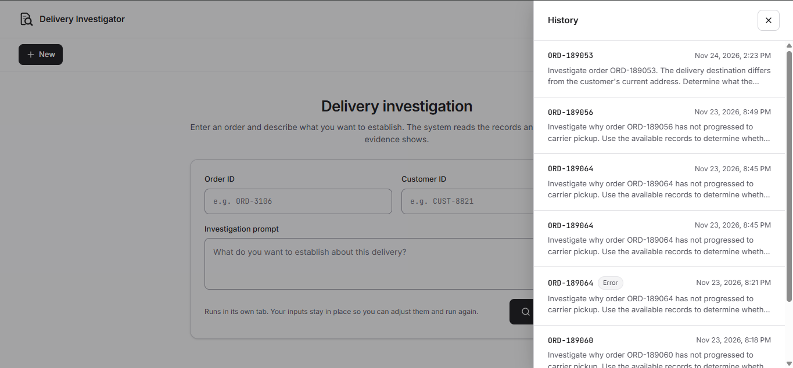
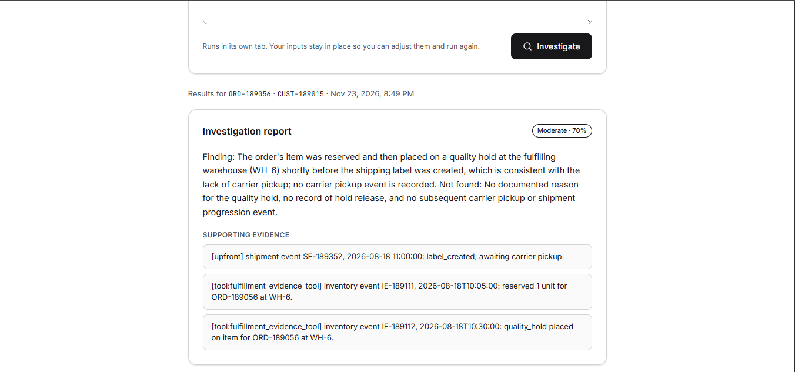
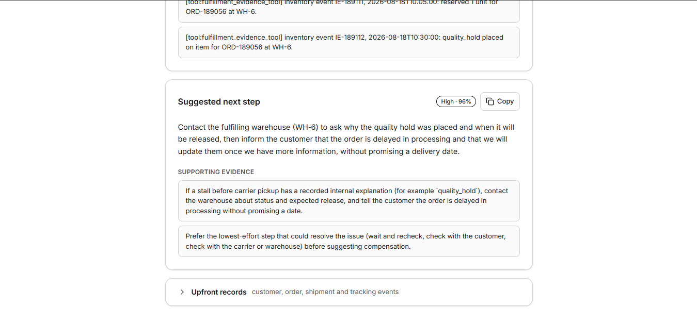
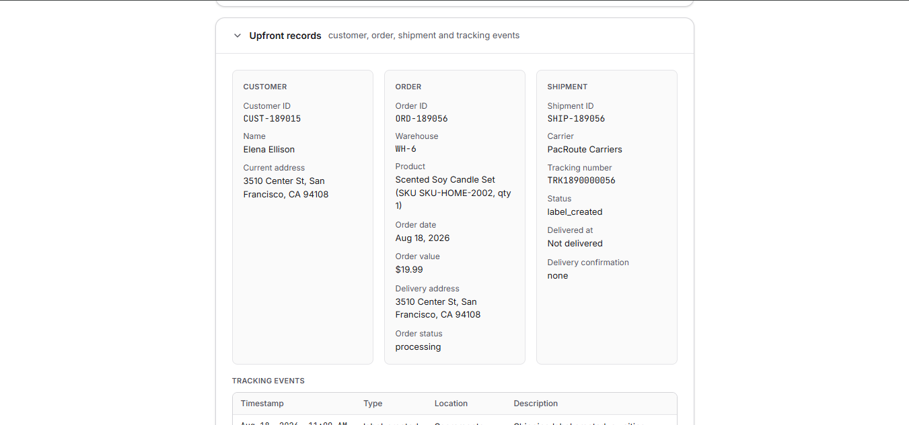
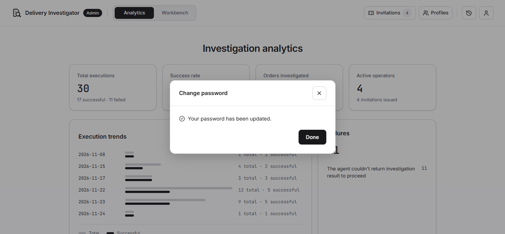
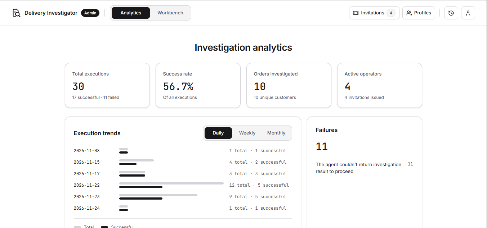
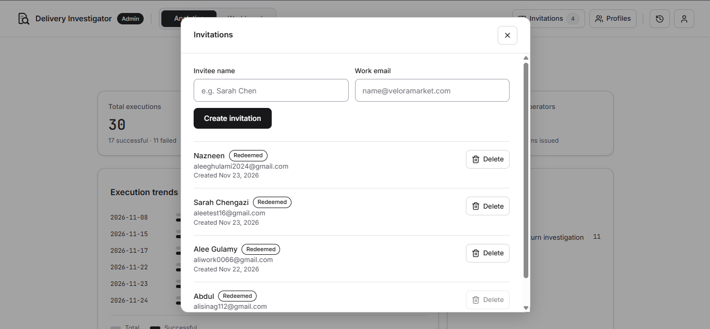
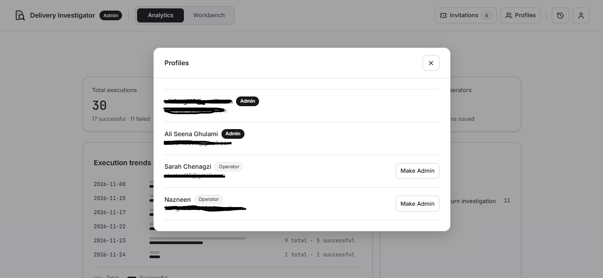

# Velora Delivery Investigator

## Introduction

Delivery Investigator is an AI-powered delivery complaint investigation system built for Velora Market, a mid-sized e-commerce company. It helps operations teams investigate problematic deliveries by analyzing order, customer, shipment, delivery event, and fulfillment-related data to identify the underlying cause of a complaint.

The system combines an AI-powered investigation pipeline with a recommendation component to produce evidence-backed investigation reports and suggest appropriate actions based on company policies. It is designed to assist human operators in making informed decisions rather than autonomously handling customer compensation or fulfillment actions.

## Problem & Project Value

Delivery-related complaints can arise from a variety of issues, including delayed shipments, failed delivery attempts, incorrect addresses, fulfillment problems, and other operational failures. Investigating these complaints often requires operators to manually review information distributed across multiple records and systems.

This process can be time-consuming and may require operators to piece together evidence before they can determine what actually happened.

Delivery Investigator addresses this problem by bringing relevant operational data together into a structured AI-powered investigation workflow. Instead of relying on assumptions or immediately suggesting customer compensation, the system focuses on identifying the underlying cause of a delivery problem and supporting its conclusions with available evidence.

The goal is to make delivery complaint investigations more efficient, consistent, and evidence-driven while keeping operational decisions in the hands of human operators.

## Key Features

- **AI-powered delivery investigation:** An AI agent analyzes relevant operational data to identify the underlying cause of delivery problems.
- **Evidence-based investigation reports:** Investigation conclusions are supported by relevant evidence retrieved from available operational records.
- **Context-aware investigation:** The system uses order, customer, shipment, shipment event, and additional fulfillment-related information when relevant.
- **Policy-based recommendations:** A recommendation component analyzes the investigation report alongside company policies to suggest an appropriate operational action.
- **Human-in-the-loop decision-making:** Operators review investigation results and recommendations before making operational decisions.
- **Execution history:** Users can access their previous investigation executions.
- **Authentication and access management:** User authentication, operator access, and administrative invitation management.
- **AI observability:** AI pipeline executions are monitored through Langfuse.
- **Evaluation:** The investigation agent has been evaluated using a structured LLM-as-a-Judge evaluation methodology.

## System Overview

Delivery Investigator consists of a frontend application and a backend application that orchestrates the investigation and recommendation pipeline.

The frontend provides the interface through which operators submit delivery investigations, review investigation reports, examine supporting evidence, and view recommended actions.

The backend handles authentication, operational data retrieval, the AI investigation pipeline, policy-based recommendations, execution history, and other application functionality.

The Investigation Pipeline consists of two primary components:

- **Investigation Agent:** An AI agent responsible for analyzing the available operational information, investigating the delivery problem, and producing an evidence-supported investigation report.
- **Recommender:** An AI component that uses the investigation report and company policies to suggest an appropriate operational action.

Supabase is used for authentication and database infrastructure, while Langfuse provides observability for AI pipeline executions.

## Investigation Workflow

The investigation workflow follows a structured process designed to prioritize relevant operational data before relying on additional investigation capabilities.

1. An operator submits an investigation request using the relevant customer and order identifiers.
2. The backend retrieves the available upfront data associated with the customer, order, shipment, and shipment events.
3. The Investigation Agent analyzes the available information to identify the underlying cause of the delivery problem.
4. When additional information is required, the agent can use its available investigation tools to gather relevant supporting evidence.
5. The Investigation Agent produces an investigation report, supporting evidence, and confidence.
6. The Recommender analyzes the investigation report alongside company policies and suggests an appropriate operational action.
7. The backend returns the investigation results and recommendation to the frontend.
8. The operator reviews the findings and decides how to proceed.

## Technology Stack

### Backend

- Python
- FastAPI
- Pydantic
- Pydantic AI
- SQLAlchemy
- PostgreSQL Database from Supabase
- OpenRouter as main LLM provider
- Groq for occasional LLM calls&#x20;

### Frontend

- React
- TypeScript

### Infrastructure & Services

- Supabase — Authentication and PostgreSQL infrastructure
- Langfuse Cloud — AI observability, tracing and for prompt management.

## Evaluation

The Investigation Agent was evaluated using an LLM-as-a-Judge methodology across a dataset of 70 problematic delivery cases.

The evaluation focuses on two primary criteria:

- **Cause correctness (80%):** Whether the agent correctly identifies the underlying cause of the delivery problem.
- **Evidence consistency (20%):** Whether the investigation report is consistent with the supporting evidence.

The evaluation uses a weighted scoring methodology and a per-case passing threshold to assess the quality of the investigation results.

The latest evaluation achieved a passing rate of **94.29% (66 out of 70 cases)**, with an average overall score of **94.3**.

The evaluation methodology, dataset, and detailed results are documented separately.

## Screenshots

## Documentation

- Client Brief
- Project Overview
- Investigation Agent Evaluation Docs
- Investigation Agent Flow Docs 
- Investigation Agent Judge Calibration Docs
- Supabase Database Configuration

## Scope & Responsibility

Delivery Investigator is designed as an investigation and decision-support system for delivery operations.

The AI investigation agent is responsible for analyzing available operational information and identifying the likely cause of a delivery problem. The recommendation component suggests an appropriate action based on the investigation findings and company policies.

The system does not autonomously issue refunds, reship orders, or execute operational decisions. Final decisions remain with the human operator.

The purpose of the system is to improve the efficiency and consistency of delivery investigations while supporting evidence-based operational decision-making.
